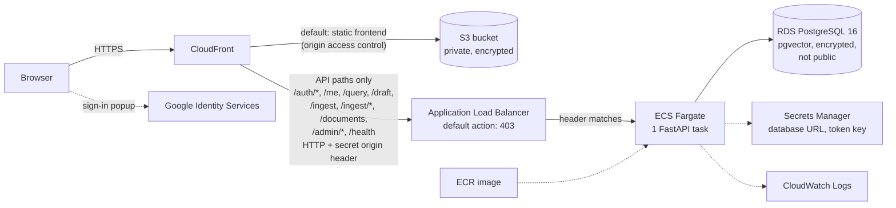

# ConsultRAG: a security-first knowledge assistant for consulting teams

[](https://github.com/Anurag-YadavIIH/consulting-rag-assistant/actions/workflows/ci.yml)

**Repo:** [github.com/Anurag-YadavIIH/consulting-rag-assistant](https://github.com/Anurag-YadavIIH/consulting-rag-assistant)

A retrieval-augmented generation (RAG) system that lets analysts and consultants
ask questions across their own research material (client slide decks, market and
secondary research, PDFs, and recorded client meetings) and get grounded,
**cited** answers, without confidential client or patient data ever leaving the
machine or leaking between engagements.

Built as a local-first system: documents are parsed, **redacted of PII/PHI**,
chunked, embedded, and indexed entirely on local hardware. No client text is sent
to any third-party API unless you explicitly wire one in.

> Why this exists: while interning as an analyst I watched a lot of time go into
> re-reading old decks, transcripts, and research to reconstruct what was already
> known about a market. This is a working prototype of the tool I wished existed,
> with the confidentiality controls a consulting/healthcare setting actually needs.

## Status

**Complete as a portfolio project.** The AWS demo was shut down on 4 November 2026 to control cost, so there is no live URL.

- **Deployed and tested on AWS:** commit `77e1695`, on 4 November 2026. The evidence (read-only AWS checks, live requests, my manual browser tests and masked screenshots) is in [docs/aws-evidence.md](docs/aws-evidence.md).
- **Added to `main` since, not deployed:** the CI pipeline and a fix that normalises Windows-style source paths the same way on Linux. They are tested in CI only, not on AWS.
- **CI:** every pull request and every push to `main` runs the backend tests (373 tests, 0 skipped, against a Postgres container), the frontend tests and static build (208 tests), Terraform checks with a mocked-provider `terraform test`, a Docker build and a secret scan. [Latest passing run on `main`](https://github.com/Anurag-YadavIIH/consulting-rag-assistant/actions/runs/41832856151); details in [docs/ci-cd.md](docs/ci-cd.md).
- **CD:** automated deployment is not built. It is future work.
- **Retrieval quality:** on a 60-question hand-labelled gold set over 214 chunks, hybrid retrieval (what the API uses) scores hit@5 0.833, recall@5 0.796 and MRR@5 0.682. The optional cross-encoder reranker (`--rerank`, CLI only) raises MRR@5 to 0.796. The corpus is small; see [BENCHMARKS.md](BENCHMARKS.md) for the caveats.

### Known limitations

- **Extractive answers.** The API quotes passages from the documents; no language model was connected in the AWS deployment.
- **No relevance threshold.** Retrieval returns the closest passages a user may see even when none answers the question. A similarity threshold was measured and could not separate the two cases ([BENCHMARKS.md](BENCHMARKS.md), 2026-11-03).
- **HTTP between CloudFront and the load balancer.** Viewers used HTTPS; the origin hop was protected by a secret header and a CloudFront-only security group, not TLS.
- **Content-Security-Policy in report-only mode** on the deployed site.
- **One API task.** The BM25 keyword index lives in memory in each API process, so running more than one task needs a shared index first.
- **No MFA on the IAM user** used for the deployment.
- **Admin engagement-selector fix not merged.** On the deployed site, an admin with no explicit memberships saw no engagements. The fix is on the branch `fix/admin-engagement-selector` and is not in `main`.

---

## What it does

- **Multimodal ingestion**: PowerPoint (slides *and* speaker notes), PDF (per
  page), plain text/markdown, and meeting audio (local transcription with
  timestamps). Each passage keeps its provenance so answers can cite the exact
  slide, page, or timestamp.
- **Confidentiality by construction**
  - PII/PHI redaction (email, phone, SSN, credit cards w/ Luhn check, medical
    record numbers, NPI, IPs, plus custom client/codename terms) runs *before*
    anything is embedded or stored. The index holds redacted text only.
  - Role-based access control with per-engagement isolation and clearance levels,
    enforced at retrieval time so one analyst can't pull another client's material
    through the assistant.
  - Append-only audit log of every ingest and query (records redaction *counts*,
    never the redacted values).
- **Grounded answers**: the model is instructed to answer only from retrieved
  context and cite sources; every response carries its supporting chunks.
- **Hybrid retrieval**: dense cosine search fused with BM25 keyword search via
  Reciprocal Rank Fusion, with an optional cross-encoder reranker (`--rerank`)
  rescoring the fused candidates down to the final top-k.
- **Local by default**: local embeddings (sentence-transformers) and a local LLM
  (via Ollama). An offline extractive mode runs with zero model downloads.
  OpenAI `text-embedding-3-large` is available as an opt-in, higher-quality
  embedder (`--embedder openai`); see "Egress notes" below.
- **Evaluated, not vibes**: a retrieval eval harness reports hit@k, recall@k, and
  MRR against a hand-labeled gold set.

## Architecture

```
                 ┌─────────────┐
  .pptx .pdf     │  Loaders    │  slides + notes / pages / timestamped audio
  .txt  audio ──▶│ (registry)  │
                 └──────┬──────┘
                        ▼
                 ┌─────────────┐   PII/PHI + custom terms removed here,
                 │  Redactor   │   BEFORE embedding. Index never sees raw PII.
                 └──────┬──────┘
                        ▼
                 ┌─────────────┐   sentence-aware, token-budgeted, overlapping
                 │   Chunker   │
                 └──────┬──────┘
                        ▼
                 ┌─────────────┐   local sentence-transformers (CPU)
                 │  Embedder   │
                 └──────┬──────┘
                        ▼
                 ┌─────────────┐   local NumPy cosine store (default);
                 │ VectorStore │   pgvector/Postgres opt-in (--store pgvector)
                 └──────┬──────┘
                        ▼
  question ─▶ embed ─▶ retrieve ─▶ ACCESS FILTER ─▶ prompt ─▶ local LLM ─▶ cited answer
                                   (RBAC + clearance)            (Ollama)
```

## AWS deployment

**Demo status: shut down to control cost** (4 November 2026). It was a temporary environment in my own AWS account, run only for testing, so there is no live URL. The screenshots and read-only AWS checks in the report were captured while it was running.

I deployed ConsultRAG to AWS with **Terraform, Docker, ECR, ECS Fargate, an Application Load Balancer, CloudFront, S3, RDS PostgreSQL with pgvector, Secrets Manager, IAM and CloudWatch**. The static frontend was served from a private S3 bucket through CloudFront over HTTPS, and CloudFront sent only the API paths to the load balancer, which accepted requests only from CloudFront.

### Architecture on AWS (as deployed)



- **One HTTPS address.** The browser talked only to CloudFront, which served the frontend from S3 and passed the API paths to the load balancer, so there was no separate API domain and no cross-site cookies.
- **The load balancer was not reachable on its own.** It answered `403` unless a request carried the secret header CloudFront adds, and its security group admitted only CloudFront's address range. A direct request from outside timed out.
- **Private data stayed private.** The database was encrypted and not publicly accessible, and secrets were injected from Secrets Manager rather than written into the image or task settings.
- **Sign-in:** Google confirmed who the user was; the API then issued its own short-lived token and read roles and clearance from Postgres on every refresh.

What was checked, and by whom:

- **Automated tests:** 356 backend and 208 frontend tests passed on the deployed commit (`77e1695`). `main` has since added CI and a Linux path fix that were not deployed; see [Status](#status).
- **Read-only AWS checks:** service health, load balancer rules, CloudFront behaviours, RDS encryption and private access, S3 public access blocks, the deployed image digest and logs.
- **Requests while it was running:** `/health` returned `200` and `/me` without a token returned a JSON `401` through CloudFront, while a direct request to the load balancer timed out.
- **Manual browser tests (reported by me):** real Google sign-in with two accounts, the first admin from `INITIAL_ADMIN_EMAILS`, an invited Analyst, and a clearance change that changed which documents could be retrieved.

The full report, with commands, UTC timestamps and known limitations, is in [docs/aws-evidence.md](docs/aws-evidence.md). Rebuild steps are in [docs/aws-frontend-runbook.md](docs/aws-frontend-runbook.md), and the earlier API-only deployment notes are in [docs/aws-deployment.md](docs/aws-deployment.md).

## Quickstart

```bash
pip install -r requirements.txt

# 1. Ingest the included sample material (offline = no model download)
python scripts/ingest.py --path data/sample --engagement acme --clearance 2 --offline

# 2. Ask a question as an analyst cleared for that engagement
python scripts/query.py "What is the barrier to adoption?" \
    --roles analyst engagement:acme --clearance 2 --offline

# 3. Score retrieval quality
python scripts/run_eval.py --offline
```

To run for real (better answers): drop `--offline` to use local embeddings, and
add `--llm ollama` to `query.py` after installing [Ollama](https://ollama.com) and
running `ollama pull llama3.1:8b`. For meeting audio, `pip install faster-whisper`.
Add `--rerank` to `query.py`/`run_eval.py` for cross-encoder reranking of the
fused candidates (downloads `BAAI/bge-reranker-base` on first use).

### Egress notes (what leaves the machine, and when)

| Flag | Default? | What it does | What leaves the machine |
|---|---|---|---|
| *(none)* | yes | Local sentence-transformers embeddings + hybrid (dense+BM25) retrieval against the local NumPy store | nothing |
| `--offline` | opt-in | Forces the hash embedder and `--store numpy`; zero network calls, zero model downloads; disables `--rerank` | nothing |
| `--embedder openai` | opt-in | OpenAI `text-embedding-3-large` embeddings | chunk/query text, to OpenAI's API |
| `--store pgvector` | opt-in | Postgres+pgvector vector store (via `docker compose up -d`) with a SQL-level RBAC filter as defense-in-depth | chunk text/vectors, to your own Postgres container: nothing external |
| `--rerank` | opt-in | Local cross-encoder reranking | nothing at query time (model weights download once) |
| Langfuse keys in `.env` | opt-in | Query tracing (question, retrieved ids+scores, latency, token usage) | question + answer text, to Langfuse Cloud (or your self-hosted instance) |
| Any protected API route (Phase 4) | n/a for CLI | OIDC token verification | fetches your IdP's (Google by default) discovery doc + public JWKS: key material only, never user/client data |

`--offline` is mutually exclusive with `--embedder openai`, `--store pgvector`,
and `--rerank`: combining them is a CLI error, not a silent fallback.

**Upcoming, not yet built** (config placeholders exist; no feature code uses
them yet: listed here so the egress story stays honest about what's actually
live vs. planned):

| Planned flag/config | What it would do | What would leave the machine |
|---|---|---|
| `--contextualize` (Groq) | LLM-generated one-line context prepended to each chunk before embedding | redacted chunk + document text, to Groq's API |
| Live web search (Tavily) | Merge current external results with internal retrieval | sanitized queries (client/engagement names stripped), to Tavily |

## Local setup (Windows + Docker Desktop)

The offline demo above needs none of this: it's only for the optional
Postgres/pgvector backend and hosted-API config.

1. **Install deps** (adds `pydantic-settings`/`python-dotenv` for config loading):

   ```bash
   pip install -r requirements.txt
   ```

2. **Start Postgres with pgvector** (requires Docker Desktop, running):

   ```bash
   docker compose up -d
   ```

   This starts a `pgvector/pgvector` Postgres container, enables the `vector`
   extension via `docker/init/01-enable-pgvector.sql`, and persists data in a
   named Docker volume (`pgdata`): nothing is written into the repo.
   Stop it with `docker compose down` (add `-v` to also drop the volume).

3. **Configure environment**: copy the example file and fill in only what you
   need; every value defaults to "off"/local, so an empty `.env` is fine:

   ```bash
   copy .env.example .env
   ```

4. **Run the existing offline demo** exactly as in the Quickstart above: it
   does not read `.env`, Postgres, or any API key:

   ```bash
   python scripts/ingest.py --path data/sample --engagement acme --clearance 2 --offline
   python scripts/query.py "What is the barrier to adoption?" --roles analyst engagement:acme --clearance 2 --offline
   python scripts/run_eval.py --offline
   ```

`src/consultrag/config.py` exposes a `Settings` object (via `pydantic-settings`)
for `OPENAI_API_KEY`, `GROQ_API_KEY`, `TAVILY_API_KEY`, `DATABASE_URL`,
`OAUTH_DISCOVERY_URL`/`OAUTH_AUDIENCE` (OIDC authentication, provider-agnostic;
see `src/consultrag/auth/oidc.py`), `LANGFUSE_PUBLIC_KEY`/
`LANGFUSE_SECRET_KEY`/`LANGFUSE_HOST`, and the existing Ollama settings, all
optional, all defaulted, and not imported by any offline code path today.

### Using the pgvector backend

```bash
pip install "psycopg[binary]" pgvector   # not installed by default
docker compose up -d                     # starts Postgres+pgvector

# Provision the schema for the embedding dimension you'll ingest with
# (384 = local default, 256 = hash, 3072 = openai). Re-run if you change
# embedders, or pick a different --table.
python scripts/migrate_pg.py --dim 384

python scripts/ingest.py --path data/sample --engagement acme --clearance 2 --store pgvector
python scripts/query.py "What is the barrier to adoption?" \
    --roles analyst engagement:acme --clearance 2 --store pgvector
```

RBAC is checked twice against this backend: a SQL `WHERE` filter on
`engagement`/`clearance` runs first (defense-in-depth, narrows what ever
leaves Postgres), then the same in-process `AccessPolicy` check that runs for
every backend. Neither replaces the other.

To verify the migration didn't change retrieval *behavior* (not RBAC; see
`consultrag.eval.evaluate`'s docstring), run the same eval set against both
backends and compare:

```bash
python scripts/run_eval.py --offline                       # numpy baseline
python scripts/run_eval.py --embedder hash --store pgvector # same embedder, pgvector backend
```

hit@k/recall@k/MRR should match within float tolerance.

### Query tracing (Langfuse)

Tracing is a no-op until configured. To enable it: sign up for
[Langfuse Cloud's free tier](https://langfuse.com), drop your public/secret
key into `.env` as `LANGFUSE_PUBLIC_KEY`/`LANGFUSE_SECRET_KEY`, and
`pip install langfuse`. Every `RAGEngine.answer()` call then emits a trace
with the question, retrieved chunk ids + scores, latency, and token usage
(when the LLM backend reports it, currently `OllamaLLM` only). Self-hosting
Langfuse is a drop-in swap via `LANGFUSE_HOST`; it isn't a docker-compose
service here given its footprint (its own Postgres + ClickHouse + Redis)
relative to this project's size.

### Which requirements file for which mode

| File | What it's for | Needed for |
|---|---|---|
| `requirements.txt` | Core offline CLI demo + base test suite | `scripts/ingest.py`/`query.py`/`run_eval.py`, `pytest tests/ -q` |
| `requirements-api.txt` | The FastAPI service (`src/consultrag/api/`) | `uvicorn consultrag.api.main:app`, the Docker image (`docker/api/Dockerfile`) |

`requirements-api.txt` references `requirements.txt` via `-r`, so installing
it alone (`pip install -r requirements-api.txt`) gets you everything needed to
run the API: you don't need to install both separately.

## API service (Phase 4)

`src/consultrag/api/` wraps the existing pipeline/RAG engine behind a FastAPI
service with Google/OIDC authentication and Postgres-backed RBAC
authorization (`src/consultrag/authz/`). Authentication (who you are) and
authorization (what you can do) are deliberately separate: a Google ID token
only ever proves identity; permissions always come from the
`engagement_memberships` table, never from the token's own claims.

```bash
pip install -r requirements-api.txt
python scripts/migrate_pg.py --dim 384
python scripts/migrate_authz.py
python scripts/seed_authz.py --google-sub <your-sub> --email you@example.com \
    --engagement acme --role analyst --clearance 2
# or, for an account that has already signed in through the frontend, by the
# "User #" number shown in its sidebar (no email or Google subject needed):
python scripts/seed_authz.py --user-id <number> --engagement acme --role analyst

uvicorn consultrag.api.main:app --reload
# or: docker compose up -d api
```

Set `OAUTH_AUDIENCE` (your Google OAuth client ID) and a real
`APP_JWT_SECRET` in `.env` first: the app refuses to start with an unset or
placeholder `APP_JWT_SECRET` (see "Fail-closed startup checks" below).

### Getting a Google ID token for manual testing

You need an OAuth 2.0 **Web application** client ID in
[Google Cloud Console](https://console.cloud.google.com/apis/credentials) to
set as `OAUTH_AUDIENCE`. To get a token to test with, the quickest path is the
[OAuth 2.0 Playground](https://developers.google.com/oauthplayground):
click the gear icon, check "Use your own OAuth credentials", paste your
client ID/secret, then on the left pick the `openid`, `email`, and `profile`
scopes, authorize, and exchange the code: the playground shows you the raw
ID token (a long `eyJ...` string). It's short-lived (about an hour), so grab
a fresh one each session.

### Calling the API from Windows PowerShell

```powershell
$googleToken = "eyJ...the ID token from the OAuth Playground..."

$login = Invoke-RestMethod -Uri "http://localhost:8000/auth/login" -Method Post `
    -Headers @{ Authorization = "Bearer $googleToken" }
$accessToken = $login.access_token

Invoke-RestMethod -Uri "http://localhost:8000/query" -Method Post `
    -Headers @{ Authorization = "Bearer $accessToken" } `
    -ContentType "application/json" `
    -Body (@{ question = "What is the barrier to adoption?"; engagement = "acme" } | ConvertTo-Json)
```

`/auth/login` returns only the access token (15 minutes) in its body. The
refresh token is set as an HttpOnly cookie for browsers (see "Sign-in" under
the frontend section), so a script that needs more than 15 minutes should
simply log in again with a fresh Google ID token.

(`Invoke-RestMethod` is PowerShell's native HTTP client; `curl` on Windows is
usually aliased to it. If you have real `curl.exe` installed, the equivalent
is `curl.exe -X POST http://localhost:8000/query -H "Authorization: Bearer $accessToken" -H "Content-Type: application/json" -d '{\"question\":\"...\",\"engagement\":\"acme\"}'`.)

### Uploading documents

`POST /ingest/upload` takes a multipart form with `file`, `engagement` and
`clearance` (default 1), so documents can be ingested without the files being
on the server. It uses the same `IngestionPipeline` as everything else, so
redaction still runs before anything is embedded or stored.

```powershell
curl.exe -F "file=@data/sample/acme_research.txt" -F "engagement=acme" -F "clearance=2" `
    -H "Authorization: Bearer $accessToken" http://localhost:8000/ingest/upload
```

- **Who can upload:** the same rules as `/ingest`. You must belong to the
  engagement (or be a global admin), and you can't upload above your own
  clearance. Clearance is 1, 2 or 3 (the levels in use); any other value
  returns `422`, for `/ingest` too.
- **File types:** `.txt`, `.md`, `.pdf` and `.pptx`, taken from the loaders.
  Audio isn't accepted through upload yet. Anything else returns `415`.
- **Size limit:** `MAX_UPLOAD_MB`, default 25. Larger files return `413`.
- **Text limit:** `MAX_UPLOAD_CHUNKS`, default 150 chunks (roughly 37,500
  words). A document whose extracted text would make more chunks returns
  `413` ("the document has too much text to process", with the limit and
  never the document's contents). It's checked after loading, redaction and
  chunking but before embedding, so a refused document costs no embedding
  time and leaves any existing document of that name unchanged. The default
  comes from a local benchmark of about 3 chunks a second on one CPU, which
  keeps processing well inside the planned 60 second CloudFront timeout.
- **Other errors:** an empty file returns `400`. A file that can't be parsed,
  or has no extractable text, returns `422`.
- **Citations** show the original filename, such as `acme_research.txt`. The
  file is written to a temporary directory under a fixed name, and the
  directory is deleted after every request, including failed ones. The
  uploaded filename is never used as a filesystem path: only its last part is
  kept, control characters are removed, and it's limited to 255 characters.
- **Re-uploading a filename** that already exists in the same engagement
  replaces that document. The old chunks are deleted and the new ones inserted
  in one database transaction, so a shorter new version leaves nothing stale
  behind and a failed upload leaves the old version in place. If any part of
  the existing document has a clearance above yours, the upload returns `409`
  and changes nothing (global admins can always replace). The same filename in
  two engagements is stored as two separate documents.

Limitations:

- **Filenames are not redacted.** Redaction covers file contents only. The
  filename is stored as provided and shown in citations, so it shouldn't
  contain client names, patient details or other sensitive data.
- **Oversized uploads still arrive before the `413`.** FastAPI receives the
  whole request before the size check runs, so the limit stops the app from
  processing a large file but doesn't stop it from being sent. A hard cap on
  request size needs to be set at the proxy or load balancer.
- **The keyword index refreshes only in the API process that handled the
  upload.** Retrieval combines vector search with a BM25 keyword index held in
  memory. After an upload, that process rebuilds its index, so new documents
  can be found straight away. Any other API process keeps its old index until
  it restarts, and finds new documents through vector search only, where they
  rank lower. One API task runs one process, so this is fine for a single
  task. Running more than one task needs a shared fix first, such as keyword
  search in Postgres or a refresh signal between tasks.
- **Tested locally only.** This was tested with the unit tests and with Docker
  Compose and Postgres on my machine:
  - `data/sample/deck.pptx` and a small generated PDF were uploaded through
    the API, and queries cited them as `deck.pptx`, slide 1, and by the PDF's
    filename, page 1, with no API restart.
  - In a browser, the Next.js upload panel uploaded `deck.pptx` and showed
    "Ingested 2 chunks from deck.pptx". A query then cited `deck.pptx`,
    slide 1, as the first source.
  - An unsupported file type returned `415` through curl. The warning banner
    for it hasn't been checked in a browser, because the file picker hides
    unsupported types.

  It hasn't been deployed or tested on AWS.

**Path-based `POST /ingest` is development-only.** It ingests any path the
server can read, so it returns `404` unless `APP_ENV` is explicitly
`development` or `dev` (the same strict allowlist as `DEV_AUTH_BYPASS`; unset
or misspelled values keep it disabled). The Streamlit UI still uses it, so
the Streamlit demo only works with `APP_ENV=development`. The Next.js
frontend uses upload. For bulk server-side ingestion, use
`scripts/ingest.py`.

### Documents, citations and activity

Tested with the unit tests and with Docker Compose and Postgres on my
machine. On AWS (4 November 2026, commit `77e1695`) I also checked uploads
with redaction counts, cited passages and the Activity page; see
[docs/aws-evidence.md](docs/aws-evidence.md).

- **Citations:** each `/query` and `/draft` citation has a `number` and the
  passage `text`. The number matches the `[n]` the passage had in the prompt,
  so an answer that cites `[2]` means citation 2. The text is the stored
  chunk, which was redacted at ingestion, and only ever from a chunk that
  passed the caller's access filter. Numbers in the answer text are only
  guaranteed in extractive mode: the Ollama prompt asks the model to cite
  `[n]`, but it may not, so a client must show the source list even when
  the answer contains no numbers.
- **`GET /documents?engagement=acme`** lists one engagement's documents:
  name, chunk count, clearance and `uploaded_at` (UTC; `null` for documents
  ingested before upload times were kept). Access is the same as `/query`.
  A document with any chunk above the caller's clearance is left out
  entirely, so it doesn't affect what's shown.
- **`DELETE /documents?engagement=acme&name=deck.pptx`** deletes one
  document. Who may delete follows the rule for replacing a document by
  uploading the same name: a member may delete a document when none of its
  chunks is above their clearance, and admins always can. A document the
  caller can't see gets exactly the same `404` as one that doesn't exist.
  The deletion and its audit event share one database transaction. The
  deleted document disappears from vector search at once and from the
  keyword index of the API process that handled the delete; other API
  processes keep their old keyword index until they restart, as after an
  upload.
- **`GET /admin/activity?limit=50&before=<id>`** pages through recent
  ingest, delete and query events, newest first, for global admins only
  (`403` otherwise). Events come from the `audit_events` table in Postgres
  (created by `scripts/migrate_pg.py`), which stores user IDs, engagements,
  document names (run through the redactor), chunk counts, redaction counts
  and retrieved and blocked counts. It stores no question text, chunk text,
  document content or email addresses. Ingest and delete events are written
  in the same transaction as the change, so a failed audit write rolls the
  change back; a failed write for a query event is logged and the query
  still succeeds. The CLI keeps its own JSON-lines file log.
- **Database connections:** `PgVectorStore` uses a small connection pool
  (`psycopg-pool`, 1 to 4 connections). A dropped connection is detected and
  replaced, which was tested by killing the pool's connections in Postgres.

### Fail-closed startup checks

The app refuses to start (not a warning but a hard error) in two cases:

- `APP_JWT_SECRET` is unset or looks like a placeholder (`""`, `"changeme"`,
  `"secret"`, shorter than 16 characters, etc.), unless `DEV_AUTH_BYPASS` is on.
- `DEV_AUTH_BYPASS=true` is set but `APP_ENV` doesn't **explicitly** equal
  `development` or `dev`. This is a whitelist, not a blacklist: an unset,
  empty, or misspelled `APP_ENV` denies bypass exactly like `APP_ENV=production`
  would; there's no "anything that isn't literally production is fine"
  fallback. When bypass *is* correctly enabled, every request is treated as a
  fixed dev user and a visible warning is logged once at startup.

It also refuses to start if `CORS_ALLOWED_ORIGINS` contains `*`. The API
allows credentialed requests (the refresh cookie), and with credentials on,
a wildcard would let any website make signed-in calls.

If `OAUTH_AUDIENCE` is unset (and bypass is off), the app still starts but
logs a warning, and every `POST /auth/login` is rejected until it's set.

`DEV_AUTH_BYPASS` is for local development only: every protected route skips
authentication entirely when it's on.

### Test coverage note: what a green CI run does and doesn't prove

Most of the API test suite (`tests/test_api.py`) needs no real Postgres:
authorization for `/ingest`/`/query`/`/draft` is decided entirely from the
verified access token's own claims, so fakes/dependency-overrides cover the
401/403 gate, spoofed-parameter rejection, and cross-engagement leakage
checks without a database. **One test is the exception**
(`test_admin_via_real_authz_store_crosses_engagements`) and it's marked
skip-if-Postgres-unreachable, same as `tests/test_pgvectorstore.py` and
`tests/test_authz_repository.py`. That means: **a green `pytest tests/ -q` run
with no Postgres running does not exercise PgVectorStore's SQL-level
isolation filter or the real authz-store admin path at all**: those are
silently skipped, not passed. Run `docker compose up -d` first if you want
those to actually execute; check for `SKIPPED` lines in `-rs` output
(`pytest tests/ -q -rs`) to know which mode you're actually in.

## Demo UI

`ui/app.py` is a thin Streamlit client over the FastAPI service: it holds no
business logic and never touches the DB, vector store, or RAG engine directly;
every server interaction goes through `ui/api_client.py`'s `query()`/`ingest()`/
`me()`. "Service + client": the API is the service, this is just a client of it.

**Not containerized.** Running `streamlit run` locally against the composed
API is sufficient for a demo: there's no `ui` service in `docker-compose.yml`
and none is planned; this keeps the compose stack to what actually needs to be
a long-running service (Postgres, the API), not a UI you'd run once to look at.

```bash
# 1. Infra + API (see "API service" above for the full sequence)
docker compose up -d
python scripts/migrate_pg.py --dim 384
python scripts/migrate_authz.py
```

```powershell
# 2. Run the API with DEV_AUTH_BYPASS for local UI use: no Google sign-in
#    needed to click around the demo. This is local-dev only; see the
#    fail-closed startup checks above for why bypass can't accidentally
#    leak into anything that looks like production.
$env:DEV_AUTH_BYPASS = "true"
$env:APP_ENV = "development"
$env:APP_JWT_SECRET = "any-real-random-secret-at-least-16-chars"
uvicorn consultrag.api.main:app --reload
```

```powershell
# 3. In a second terminal: the UI's own, separate dependency set
pip install -r requirements-ui.txt
$env:API_BASE_URL = "http://localhost:8000"   # default if unset
streamlit run ui/app.py
```

`requirements-ui.txt` is a *third* independent dependency set (base / api /
ui): `streamlit` + `httpx` only, nothing from `requirements.txt` or
`requirements-api.txt` pulled in or duplicated.

**The production demo path is real Google sign-in, not bypass.** Every
auth-related decision in the UI funnels through one function,
`get_auth_headers()` in `ui/api_client.py`, commented as the single seam
that changes when Google OIDC sign-in replaces `DEV_AUTH_BYPASS`; nothing
else in the UI assumes how auth works.

The UI degrades gracefully if the API isn't running: `ui/api_client.py`
catches transport-level failures (connection refused, timeout), not just
HTTP error statuses, and `ui/app.py` renders a plain "can't reach the API"
message instead of a stack trace.

## Frontend (Next.js)

`frontend/` is a Next.js (App Router) + TypeScript + Tailwind client over the
same FastAPI service the Streamlit UI talks to: same "service + client"
split: all business logic, auth, and RBAC stay server-side, and every call
goes through one typed wrapper, `frontend/lib/api.ts`
(`me()`/`query()`/`uploadDocument()`/`ingest()`, mirroring
`ui/api_client.py`'s pattern in TypeScript). The ingest panel uploads a file
picked from your computer through `POST /ingest/upload`. It is a **separate, independent dependency set**
(`frontend/package.json`, npm): it doesn't touch `requirements.txt`,
`requirements-api.txt`, or `requirements-ui.txt`, and installing/running it
has no effect on the offline CLI demo or any `pytest tests/` run.

### Running it locally (Windows)

```powershell
# 1. Infra + API (same as "Demo UI" above)
docker compose up -d
python scripts/migrate_pg.py --dim 384
python scripts/migrate_authz.py
```

```powershell
# 2. Run the API with DEV_AUTH_BYPASS: no Google sign-in needed locally.
#    Local-dev only; see "Fail-closed startup checks" above.
$env:DEV_AUTH_BYPASS = "true"
$env:APP_ENV = "development"
$env:APP_JWT_SECRET = "any-real-random-secret-at-least-16-chars"
$env:CORS_ALLOWED_ORIGINS = "http://localhost:3000"
uvicorn consultrag.api.main:app --reload
```

```powershell
# 3. In a second terminal: the frontend's own dependency set
cd frontend
copy .env.local.example .env.local
# .env.local.example documents NEXT_PUBLIC_API_BASE_URL (defaults to
# http://localhost:8000) and NEXT_PUBLIC_FALLBACK_ENGAGEMENTS.
npm install
npm run dev
```

Open `http://localhost:3000`. `CORS_ALLOWED_ORIGINS` on the API side defaults
to empty (no browser origin allowed); it must be set explicitly, as above,
for the browser-based frontend to reach the API at all; see `config.py`.

### Sign-in (Google)

With DEV_AUTH_BYPASS off, the frontend shows a "Sign in with Google" screen
and renders no app data until there's a session. All of the auth logic is in
`frontend/lib/auth.ts`:

- Google Identity Services gives the browser a Google ID token, which is sent
  once to `POST /auth/login`. The API checks the signature (RS256, Google's
  published keys), issuer, audience (`OAUTH_AUDIENCE`), expiry (30 seconds of
  clock leeway) and that the email is verified, then returns an app access
  token.
- **Access token:** 15 minutes, kept in memory only (never in localStorage or
  sessionStorage), so a reload drops it.
- **Refresh token:** 7 days from sign-in, set by the API as an `HttpOnly`,
  `Secure`, `SameSite=Strict` cookie on `Path=/auth`. Page scripts can't
  read it. `POST /auth/refresh` and `POST /auth/logout` also require the
  `X-ConsultRAG-CSRF` header.
- On a 401 the frontend refreshes once and retries the request once. A
  reload recovers the session the same way. If the refresh fails, it goes
  back to the sign-in screen.
- A failed refresh always returns the same 401 (`not signed in`), so callers
  can't tell why. The API logs only a category at INFO level
  (`missing_cookie`, `expired`, `revoked`, `invalid` or `unknown_user`),
  never the token, its claims, the email or the secret.
- Every refresh re-reads roles and clearance from Postgres, so a granted or
  removed role takes effect at the next refresh (at most 15 minutes).
- **Sign out** revokes on the server, not just in this browser: the API
  increments the account's refresh version, which rejects every refresh
  token the account holds, in any browser. An access token that was already
  issued stays valid until it expires (up to 15 minutes), because protected
  routes don't check the database.
- A Google account nobody has granted anything gets a user row (clearance 1,
  no roles) and sees "No access yet". `/query` and `/draft` return 403 for
  it, upload returns 403, and `/me` only describes the account itself.

To sign in locally against the composed API:

```powershell
# API: bypass off, your OAuth web client ID as the audience, a real random
# APP_JWT_SECRET, and the frontend's origin allowed for credentialed CORS.
$env:DEV_AUTH_BYPASS = "false"
$env:APP_ENV = "production"
$env:OAUTH_AUDIENCE = "<your-client-id>.apps.googleusercontent.com"
$env:CORS_ALLOWED_ORIGINS = "http://localhost:3000"

# Frontend: NEXT_PUBLIC_GOOGLE_CLIENT_ID is the same client ID.
cd frontend
$env:NEXT_PUBLIC_GOOGLE_CLIENT_ID = "<your-client-id>.apps.googleusercontent.com"
npm run dev     # or: npm run build, then serve frontend/out/ on port 3000
```

In Google Cloud Console, list both `http://localhost:3000` and
`http://localhost` as authorized JavaScript origins for the client. Without
the second one, Google's button can fail with "The given origin is not
allowed for the given client ID". Sign in once, then grant access with
`scripts/seed_authz.py --user-id <number> ...` (see "API service") and reload.

**What was tested:** the unit tests, plus a manual run on my machine with
Docker Compose (`APP_ENV=production`, bypass off) and the static export
served on `http://localhost:3000` in Chrome: sign-in, "No access yet" before
any grant, access after granting acme, an acme upload and query, sign-out,
and reloads before and after signing out. Real Google sign-in with two
accounts was also tested on AWS on 4 November 2026; see
[docs/aws-evidence.md](docs/aws-evidence.md).

Limitations:

- **The Streamlit UI still works only with DEV_AUTH_BYPASS.** It never used
  `/auth/login` or `/auth/refresh`, and has no Google sign-in.
- **Admins see a fixed engagement list.** An admin with no explicit
  memberships gets `NEXT_PUBLIC_FALLBACK_ENGAGEMENTS` in the selector. The
  admin-only `GET /admin/engagements` exists, but the change that uses it is
  on the unmerged branch `fix/admin-engagement-selector`. Non-admins only
  ever see their own memberships.
- **Chunks with no engagement** (CLI ingests without `--engagement`) are
  readable by any account that has at least one engagement or is an admin,
  as before. Accounts with no access can't query, so they can't reach them.
- **The local run used `http://localhost`.** Browsers accept `Secure` cookies
  there; anywhere else, sign-in needs HTTPS. On AWS the site was served over
  HTTPS through CloudFront; see `docs/aws-evidence.md`.

### The Ask page and what its scores mean

The frontend's Ask page shows the **closest passages** to a question, quoted
from the documents the user can access, each with a citation button that
opens the source (filename, location, passage, and redaction bars only where
the server redacted something). The API answers in extractive mode: it
quotes passages ranked by similarity and doesn't write a summary, so the page
says the passages "may not fully answer your question".

- Responses keep the plain-text `answer` (for the CLI and `/draft`) and add
  `mode` and `quotes`, so clients don't parse text.
- Each citation has a `score_kind`: `similarity` (dense cosine, 0 to 1) or
  `keyword` (a raw BM25 score on a different, unbounded scale). Only
  similarity is shown as a number, and no score is a confidence.
- When nothing the user can see is retrieved, the answer is "I couldn't
  find this in the documents you can access." with no citations, the same
  whether or not hidden documents exist.

**Known limitation:** when something is retrieved, it's shown even if it
doesn't answer the question. A minimum-similarity threshold was measured and
can't separate answerable from unanswerable questions on this corpus (see
`BENCHMARKS.md`, 2026-11-03), so none is applied. A cross-encoder relevance
score or a grounded generative model are possible future work.

The **Documents** page lists the selected engagement's documents from
`GET /documents` (only those the user can see at their clearance), deletes
one after a confirmation dialog, and uploads with drag and drop. The
**Activity** page (admins only; the server enforces it) pages through
`GET /admin/activity`, newest first, with an event-type filter
(`?event=ingest|delete|query`). The **sign-in** page states only what the
code enforces: redaction before storage, separation by engagement and
clearance, and a citation on every passage shown.

The UI also has Light, Dark and System themes, self-hosted fonts (no runtime
requests to Google) and a phone layout. `scripts/seed_demo_data.py` loads
fictional demo engagements (Meridian Health, Kestrel Medical) into a **local**
Compose database only; it refuses to run with `APP_ENV=production` or a
non-local database. Tested locally with Docker Compose and in Chrome, **not on
AWS**.

### Team access (admins)

Admins give people access in the app, on the **Team** page, without shell
commands. Tested with unit tests and Docker Compose locally, and on AWS on
4 November 2026: the first admin from `INITIAL_ADMIN_EMAILS`, an invitation,
a change from Analyst to Manager, and removal (reported in
[docs/aws-evidence.md](docs/aws-evidence.md)).

- **First admin:** `INITIAL_ADMIN_EMAILS` (comma-separated). A listed
  account becomes a global admin with clearance 3 the first time it signs in,
  and only if Google reports the email as verified. It happens once per
  account: the time it applied is stored in `users.initial_admin_applied_at`,
  set in the same transaction as the grant with the user row locked, so a
  later demotion sticks while the email is still listed and two sign-ins at
  once grant it a single time. The API logs it by user number, never the
  email.
- **Invitations:** an admin invites a Google account email (case doesn't
  matter) with engagements and a clearance. It applies once, at that
  person's first verified sign-in, and expires after `INVITATION_TTL_DAYS`
  (default 14). No email is sent; share the app link.
- **Role presets** are shortcuts: Analyst (clearance 1), Manager (2),
  Senior management (3) and Admin (global admin, clearance 3). Only three
  things control access: engagement membership, clearance and the global
  admin role. Membership labels like "manager" grant nothing by themselves,
  and admins are still limited by their clearance when reading documents.
- **Optional domain rule:** `ALLOWED_EMAIL_DOMAINS` (comma-separated). When
  set, other domains get a 403 at sign-in, except invited emails and
  `INITIAL_ADMIN_EMAILS`. Refused accounts get no user record. A malformed
  value (for either setting) makes the API refuse to start.
- **Safety rules:** every `/admin` team route checks the admin role in the
  token and again in the database. The last admin can't be removed or
  demoted, admins can't remove their own admin rights or access, clearance
  must be 1 to 3 (also for upload, `/ingest` and the scripts), and
  destructive actions ask for confirmation. An admin at clearance 3 can read
  and manage every document.
- **Admin is global only:** only a membership row with no engagement grants
  admin. A row for an engagement labelled "admin" grants that engagement and
  nothing more; the API, the repository and `seed_authz.py` refuse to create
  one.
- **When changes apply:** at the person's next token refresh at the latest.
  Removing someone also revokes their refresh tokens (they must sign in
  again, which gets them nothing), but **an access token that was already
  issued can keep working for up to 15 minutes.**
- **Audit:** every change is recorded in `audit_events` with the actor's
  user number, the target user number or invitation number, the action,
  engagement and clearance. No email addresses are stored there.

`scripts/seed_authz.py` still works as a fallback (for example
`--user-id 90 --admin --clearance 3`), and now refuses `--role admin` with
`--engagement` and a clearance outside 1 to 3. Use `--admin` for the global
admin role.

### Static export

`next.config.js` sets `output: "export"` and `trailingSlash: true`, so
`npm run build` writes plain files to `frontend/out/` (for example
`management/index.html`) for static hosting such as S3 and CloudFront.
`npm run dev` works as before. `npm start` doesn't apply to a static export;
serve `out/` instead. `NEXT_PUBLIC_*` values are baked in at build time.

The Management area (`frontend/app/management/page.tsx`) only *renders* for
high-clearance/admin users per `/me`: that gate is convenience/UI tidiness,
not a security boundary. The backend enforces clearance and engagement
membership on every endpoint regardless of what the frontend shows or hides.

### Tests

```bash
cd frontend
npm run test    # vitest, fetch mocked; needs no live backend
npm run build   # static export to out/
```

### A note on `npm install` audit output

A fresh `npm install` currently reports a handful of dev-tooling advisories
(esbuild's dev server allowing cross-origin requests; PostCSS's CSS
stringify XSS): both are build/dev-time concerns in transitive
dependencies of Next.js/Vitest, not runtime exploits in this app's code.
`npm audit fix --force` "fixes" them by downgrading `next` to `9.x`, which
is not an upgrade, so it is left unapplied deliberately rather than silently
regressing the framework version.

## Design decisions (and the trade-offs)

- **Redaction before indexing, not at display time.** Stronger guarantee (raw PII
  is never persisted), at the cost of not being able to "un-redact" later.
- **Vector store written from scratch on NumPy, default backend.** Keeps everything
  local and makes the retrieval math inspectable. `PgVectorStore` (`--store
  pgvector`) is available when the corpus outgrows in-memory cosine search or
  you want SQL-level RBAC filtering as defense-in-depth.
- **Local LLM by default.** Confidentiality over raw answer quality; the LLM
  interface is pluggable if you accept a hosted model.
- **Sentence-aware overlapping chunks (~350 tokens, ~50 overlap).** Balances
  retrieval precision against context fragmentation.

## Tests & evaluation

```bash
python -m pytest tests/ -q        # unit + end-to-end (incl. access-control) tests
python scripts/run_eval.py --offline
```

On `main`, CI runs 373 backend tests (with 0 skipped, so every Postgres-backed
test really runs), 208 frontend tests, the type check, the static build and a
mocked-provider `terraform test` with 13 runs. See [docs/ci-cd.md](docs/ci-cd.md)
and the [latest run on `main`](https://github.com/Anurag-YadavIIH/consulting-rag-assistant/actions/runs/41832856151).

Retrieval metrics are reported on `eval/eval_set.jsonl`. Replace the sample set
with a real 20 to 30 question gold set from your own corpus to get meaningful numbers.
Recorded baseline runs (date, gold-set size, embedder, config, literal
hit@k/recall@k/MRR for both backends) live in [BENCHMARKS.md](BENCHMARKS.md);
append a new dated entry there each time the eval set or retrieval pipeline
changes meaningfully, rather than relying on memory of "it used to be X".

## Roadmap

Not built yet:

- Automated deployment (CD) from CI to AWS
- A way to say "not in the documents": a cross-encoder relevance score or a
  grounded generative model, measured the same way as the threshold study in
  [BENCHMARKS.md](BENCHMARKS.md) before it is turned on
- Enforcing the CSP, HTTPS from CloudFront to the load balancer, and a shared
  keyword index so the API can run more than one task
- Speaker diarization for meeting audio (pyannote; an extension point in the
  audio loader)
- Groq-backed contextual chunking (config placeholder exists; not implemented)
- Live web search (Tavily) merged with internal retrieval, with an outbound
  query sanitizer (config placeholder exists; not implemented)
- A RAGAS-style/LLM-judge generation eval (faithfulness, answer relevancy)
- Presidio-based NER redaction for names/orgs/locations (a hook,
  `redact_with_presidio`, exists but is not wired in)

## Project layout

```
src/consultrag/
  ingestion/    loaders (pptx, pdf, text, audio) + registry
  security/     redaction (PII/PHI) + RBAC access control
  chunking.py   sentence-aware overlapping chunker
  embeddings.py local, hash (offline), and OpenAI embedders
  vectorstore.py  local NumPy cosine vector store with persistence (default)
  pgvectorstore.py  Postgres+pgvector store, opt-in via --store pgvector
  retrieval.py  hybrid (dense+BM25) retrieval fused with RRF
  reranking.py  optional cross-encoder reranker
  tracing.py    Langfuse query tracing (no-op unless configured)
  config.py     typed settings loaded from .env (pydantic-settings)
  pipeline.py   ingest orchestration (load→redact→chunk→embed→store)
  rag.py        retrieve→access-filter→rerank→prompt→LLM→cited answer
  audit.py      append-only audit log
  eval.py       hit@k / recall@k / MRR (hybrid retrieval, RBAC-free by design)
  authz/        Postgres-backed RBAC: users + engagement_memberships
  auth/         authentication: OIDC verification, app session tokens,
                DEV_AUTH_BYPASS (auth != authz; see "API service" above)
  api/          FastAPI service: /auth/login, /auth/refresh, /auth/logout,
                /ingest/upload, /ingest (development only), /query, /draft,
                /me, /documents, /admin (team access and activity)
scripts/        ingest.py, query.py, run_eval.py, migrate_pg.py,
                migrate_authz.py, seed_authz.py
ui/             api_client.py (thin httpx wrapper, no business logic),
                app.py (Streamlit demo client; see "Demo UI" above)
frontend/       Next.js + TypeScript client (lib/api.ts, lib/auth.ts);
                see "Frontend (Next.js)" above
tests/          unit, API, Postgres-backed, access-control and Terraform
                tests (373 in CI)
docker/         API image (docker/api/Dockerfile) and the local Postgres init
infra/terraform/  AWS infrastructure, with a mocked-provider terraform test
docs/           AWS evidence, deployment notes, runbook and CI/CD notes
.github/workflows/  CI (ci.yml)
```
