# ConsultRAG on AWS: evidence report

**Status:** shut down to control cost on 4 November 2026. This was a temporary environment in my own AWS account (region `ap-south-1`), run only to test the deployment. The URLs in this report no longer work.
**When the evidence was captured:** on 4 November 2026, while the environment was running. The read-only AWS checks and HTTP requests ran between 09:57 and 10:04 UTC, and I took the screenshots during the same session.

This report records what was actually deployed and checked, so it can be verified rather than taken on trust. Each item says who verified it and how. Account IDs, IP addresses, emails, ARNs that contain the account ID, tokens, cookies and the origin secret header value are masked or left out.

## Summary

- The static Next.js frontend was served from a private S3 bucket through CloudFront over HTTPS. The FastAPI backend ran as one ECS Fargate task behind an Application Load Balancer, and CloudFront sent only the API paths there.
- The load balancer forwarded only requests that carried a secret origin header. Its security group admitted only CloudFront's origin-facing address range. A direct request from outside timed out.
- Data was stored in an encrypted RDS PostgreSQL (pgvector) instance that was not publicly accessible. The database URL and the token signing key were in Secrets Manager.
- Through CloudFront, `GET /health` returned `200` and `GET /me` without a token returned a JSON `401`.
- In manual browser tests (reported below), two real Google accounts signed in, the first became admin, the second joined by invitation, and changing its clearance changed which documents it could retrieve.

## Architecture (as deployed)

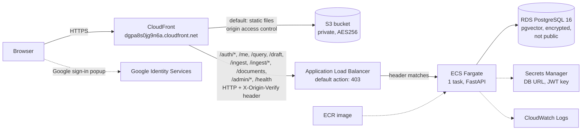

## What was deployed

| Item | Value | How it was established |
|---|---|---|
| Repository | [github.com/Anurag-YadavIIH/consulting-rag-assistant](https://github.com/Anurag-YadavIIH/consulting-rag-assistant) | `git remote get-url origin` |
| Branch and commit | `main` at `77e1695` ("Labelled redaction bars, interactive sign-in panel, checked local build", 2026-11-04T07:54:44Z) | See the next two rows |
| Frontend | Built from `77e1695` | The JavaScript served at the time contained text added in `77e1695` (the sign-in "how it works" panel and labelled redaction bars) and not the change in the later commit `33163db`. `index.html` in S3 was last modified 2026-11-04T09:07:47Z. |
| API image | `sha256:cfa75bf884a8b55955c0558b313509a14e15fc50ed4aa1ef0b0384cba3badcae`, tag `latest`, pushed 2026-11-04T08:52:19Z | ECR `describe-images`; the running task reports the same digest. **Inferred, not proven:** the image has no git label, but it was pushed after `77e1695`, and no API code changed between `77e1695` and the next commit. |

The fix for an admin engagement-selector bug found while the site was running is on the branch `fix/admin-engagement-selector` (`33163db`). It was **not** deployed during this snapshot.

## What was verified, by whom and how

### 1. Automated tests (run by Claude Code)

Run on 2026-11-04 against commit `77e1695` (the deployed commit), on my Windows machine with local Postgres:

| Suite | Command | Result |
|---|---|---|
| Backend (pytest) | `python -m pytest -q` | 356 passed |
| Frontend (vitest) | `npx vitest run` | 208 passed (14 files) |
| Type check | `npx tsc --noEmit` | no errors |

These cover, among other things, engagement and clearance filtering, redaction before storage, the admin-only Team routes, the once-only initial admin grant, and the token refresh flow.

### 2. Read-only AWS checks (run by Claude Code)

All commands used `--profile consultrag --region ap-south-1` and only `describe`, `list` or read-only `get` operations. No secret values were read. Times are UTC on 2026-11-04.

| Time | What | Command | Result |
|---|---|---|---|
| 09:58:10 | ECS service | `aws ecs describe-services --cluster consultrag --services consultrag-api` | `ACTIVE`, running 1, desired 1, pending 0, launch type `FARGATE`, task definition `consultrag-api:2`, deployment `COMPLETED` |
| 09:58:13 | Task definition | `aws ecs describe-task-definition --task-definition consultrag-api:2` | 1 vCPU, 3 GB, `FARGATE`. Environment names only: `APP_ENV=production`, `DEV_AUTH_BYPASS=false`, `INVITATION_TTL_DAYS=14`, `OAUTH_AUDIENCE`, `INITIAL_ADMIN_EMAILS` (set, value not shown), `ALLOWED_EMAIL_DOMAINS` (empty). Secrets injected by reference: `APP_JWT_SECRET`, `DATABASE_URL` |
| 09:58:20 | Running task | `aws ecs describe-tasks --cluster consultrag --tasks <task-id>` | `RUNNING`, `FARGATE`, started 09:00:16, image digest `sha256:cfa75bf8...` |
| 09:59:12 | Listener | `aws elbv2 describe-listeners --load-balancer-arn <alb-arn>` | HTTP on port 80. Default action: `fixed-response` `403` with body `{"detail":"Forbidden"}` |
| 09:59:15 | Listener rules | `aws elbv2 describe-rules --listener-arn <listener-arn>` | Priority 10: condition type `http-header` on `X-Origin-Verify` (value redacted), action `forward`. Default rule: `fixed-response` |
| 09:59:18 | Target health | `aws elbv2 describe-target-health --target-group-arn <tg-arn>` | 1 target on port 8000, `healthy` |
| 09:59:20 | Load balancer security group | `aws ec2 describe-security-groups --group-ids <alb-sg>` | Inbound TCP 80 only from prefix list `com.amazonaws.global.cloudfront.origin-facing` (confirmed with `aws ec2 describe-managed-prefix-lists`) |
| 09:59:24 | Task security group | `aws ec2 describe-security-groups --group-ids <task-sg>` | Inbound TCP 8000 only from the load balancer's security group |
| 09:59:30 | CloudFront | `aws cloudfront get-distribution --id <distribution-id>` | `Deployed`, enabled, domain `dgpa8s0jg9n6a.cloudfront.net`, HTTP/2 and HTTP/3. Origins: the S3 bucket through origin access control, and the load balancer (`http-only`, custom header `X-Origin-Verify` with the value removed). Default behaviour goes to S3 with `redirect-to-https`. API path behaviours to the load balancer: `/auth/*`, `/me`, `/query`, `/draft`, `/ingest`, `/ingest/*`, `/documents`, `/admin/*`, `/health` |
| 09:59:33 | RDS | `aws rds describe-db-instances` | `available`, `postgres` `16.13`, `db.t4g.micro`, storage encrypted `true`, `PubliclyAccessible` `false`, single AZ, backup retention 0 days, deletion protection off |
| 09:59:39 | S3 public access | `aws s3api get-public-access-block --bucket <frontend-bucket>` | `BlockPublicAcls`, `IgnorePublicAcls`, `BlockPublicPolicy`, `RestrictPublicBuckets` all `true` |
| 09:59:42 | S3 encryption | `aws s3api get-bucket-encryption --bucket <frontend-bucket>` | `AES256` (SSE-S3) |
| 09:59:48 | ECR | `aws ecr describe-images --repository-name consultrag-api` | `latest` = `sha256:cfa75bf8...`, pushed 08:52:19, about 643 MB. Scan on push is off |
| 09:59:51 | Secrets Manager | `aws secretsmanager list-secrets --query "SecretList[].{Name:Name,LastChanged:LastChangedDate}"` | Names only: `consultrag/database-url`, `consultrag/app-jwt-secret` |
| 09:59:53 | CloudWatch | `aws logs describe-log-groups --log-group-name-prefix /ecs/consultrag` | `/ecs/consultrag-api`, retention 7 days |
| 10:02:34 | Recent API logs | `aws logs filter-log-events --log-group-name /ecs/consultrag-api --start-time <3 hours ago>` | 368 events, none containing an email address. Excerpt below (user numbers masked) |
| 10:03:38 | IAM MFA | `aws iam list-mfa-devices` | 0 MFA devices on the IAM user used for the deployment |

Log excerpt (only lines without personal data; access-log lines are left out because they contain client IP addresses):

```text
2026-11-04T08:55:23Z  Schema ready: table 'chunks' (dim=384)
2026-11-04T08:55:23Z  Audit schema ready: table 'audit_events'
2026-11-04T08:55:23Z  Authz schema ready
2026-11-04T09:00:03Z  INFO:     Application startup complete.
2026-11-04T09:09:00Z  INFO:     consultrag.api.routes.auth: refresh rejected: reason=missing_cookie
2026-11-04T09:09:57Z  INFO:     consultrag.authz.team: sign-in grant applied: initial_admin for user_id=<N>
2026-11-04T09:43:54Z  INFO:     consultrag.authz.team: sign-in grant applied: invitation for user_id=<N>
```

### 3. HTTP checks while the environment was running (run by Claude Code)

| Time (UTC) | Request | Result |
|---|---|---|
| 10:00:54 | `curl -s -i https://dgpa8s0jg9n6a.cloudfront.net/health` | `200`, body `{"status":"ok","version":"0.2.0"}`, `server: uvicorn` |
| 10:00:54 | `curl -s -i https://dgpa8s0jg9n6a.cloudfront.net/me` (no token) | `401`, `Content-Type: application/json`, body `{"detail":"missing Authorization header"}` |
| 10:00:54 | `curl -s -D - -o /dev/null https://dgpa8s0jg9n6a.cloudfront.net/` | `200` with `Strict-Transport-Security`, `X-Content-Type-Options: nosniff`, `X-Frame-Options: DENY`, `Referrer-Policy: strict-origin-when-cross-origin` and `Content-Security-Policy-Report-Only` |
| 10:01:20 | `curl --max-time 10 http://<alb-dns-name>/health` (direct to the load balancer) | No response; curl exit code 28 (timed out after 10 s) |
| 10:01:30 | The same with a guessed `X-Origin-Verify` header | No response; curl exit code 28 |

### 4. Manual browser tests (reported by me, with screenshots below)

I ran these myself in a browser on the CloudFront URL. They are reported by me; Claude Code did not observe them directly. Most are backed by the screenshots in the next section.

1. Real Google sign-in worked for two accounts on the CloudFront URL.
2. The first account became admin through `INITIAL_ADMIN_EMAILS`.
3. An invited second account joined as Analyst, clearance 1.
4. As Analyst, "What is the main barrier to adoption?" returned 2 sources, both `deck.pptx`. `acme_research.txt` was hidden.
5. After changing that account to Manager, clearance 2, the same question returned 3 sources including `acme_research.txt`.
6. Passages showed labelled redactions for email, phone and medical record number.
7. The Activity page showed "2 passages returned, 1 withheld by access rules" for the Analyst, then "3 passages returned" for the Manager, with user numbers and no question text or emails.
8. Removing the second account showed "Access removed", and its next reload showed "No access yet".
9. A direct curl to the load balancer timed out, as expected.
10. Uploads on AWS reported "3 items redacted" and "1 item redacted".

Server-side corroboration (checked by Claude Code): the API log shows `sign-in grant applied: initial_admin` at 09:09:57 UTC and `sign-in grant applied: invitation` at 09:43:54 UTC (items 2 and 3), and Claude Code's own direct request to the load balancer also timed out (item 9, section 3).

## Screenshots

I took these screenshots myself during the tests on 4 November 2026. In the copies here, email addresses, ARNs containing the account ID, and one private IP address are covered with solid black rectangles; nothing else was edited, and image metadata was removed. Times in the app screenshots are in my local time zone (UTC+5:30).

### Analyst at clearance 1 (supports item 4)

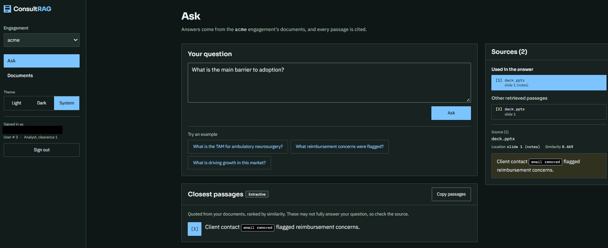

The invited account (User # 3, Analyst, clearance 1) asked "What is the main barrier to adoption?". Sources (2): `deck.pptx` slide 1 (notes) and `deck.pptx` slide 1. The quoted passage shows an "email removed" redaction label. Email masked.

### Manager at clearance 2 (supports items 5 and 6)

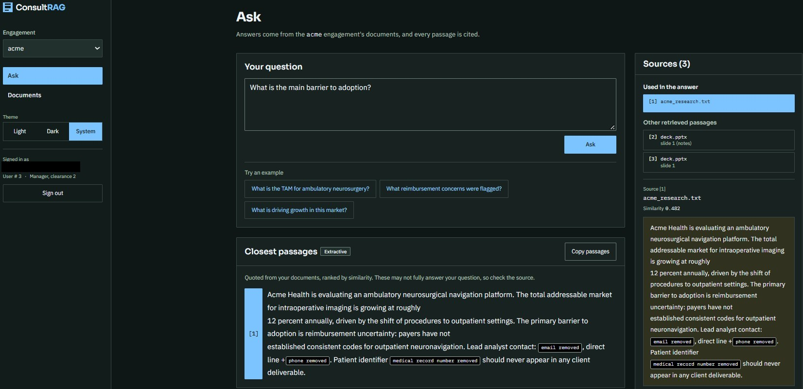

The same account (User # 3, now Manager, clearance 2) asked the same question. Sources (3): `acme_research.txt` used in the answer, and two `deck.pptx` passages. The passage shows labelled redactions for email, phone and medical record number. Email masked.

### Team page (supports items 2, 3 and the clearance change)

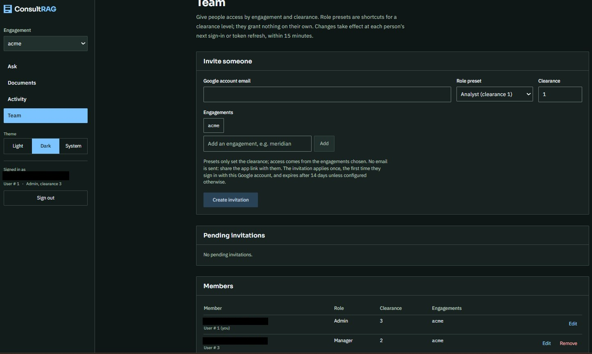

Signed in as User # 1 (Admin, clearance 3). Members: User # 1 Admin, clearance 3, `acme`; User # 3 Manager, clearance 2, `acme`. No pending invitations. Emails masked.

### Activity log (supports items 2, 3, 7 and 10)

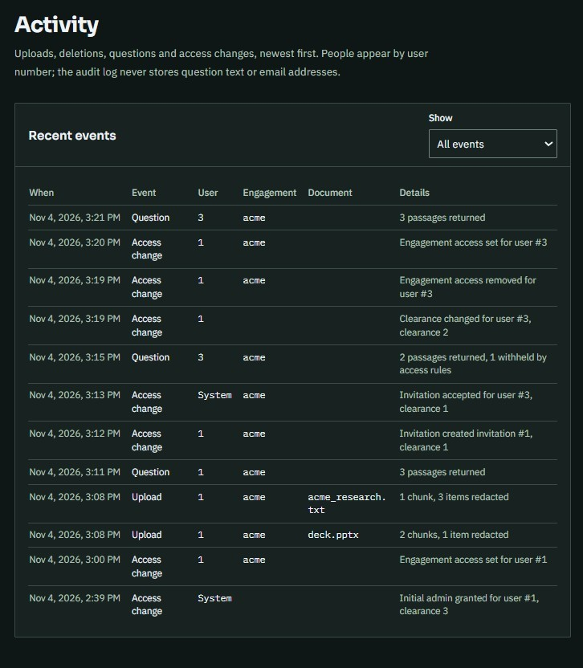

Events shown by user number, with no question text or email addresses: initial admin granted for user #1 (clearance 3), the invitation created and accepted for user #3 (clearance 1), uploads of `deck.pptx` ("2 chunks, 1 item redacted") and `acme_research.txt` ("1 chunk, 3 items redacted"), a question by user 3 with "2 passages returned, 1 withheld by access rules", the clearance change to 2, and a later question by user 3 with "3 passages returned". Nothing needed masking in this image.

### Access removed (supports item 8)

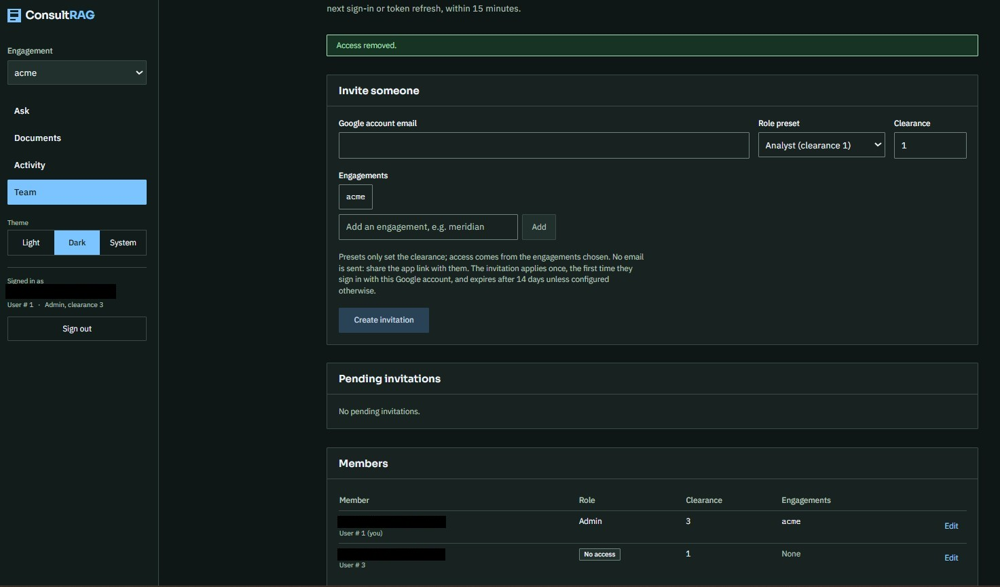

After the admin removed the second account: the "Access removed." notice, and User # 3 listed with "No access", clearance 1, engagements "None". Emails masked.

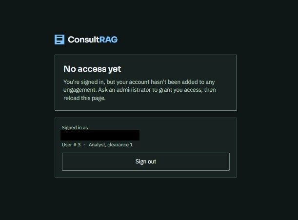

The removed account's next reload: "No access yet", signed in as User # 3. Email masked.

### AWS console (supports section 2)

These are console views I captured while the environment was running. They support, and do not replace, the read-only CLI checks in section 2.

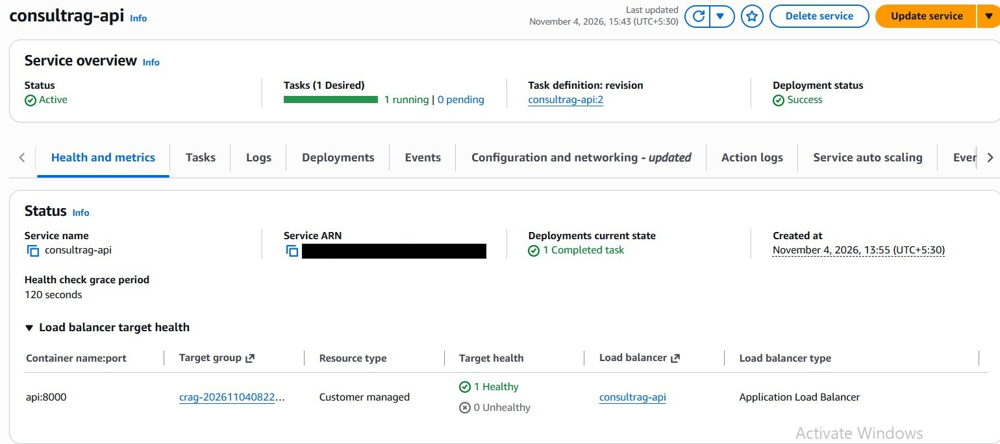

ECS service `consultrag-api`: status Active, 1 desired, 1 running, 0 pending, task definition `consultrag-api:2`, deployment Success, load balancer target `api:8000` with 1 healthy and 0 unhealthy. Service ARN masked.

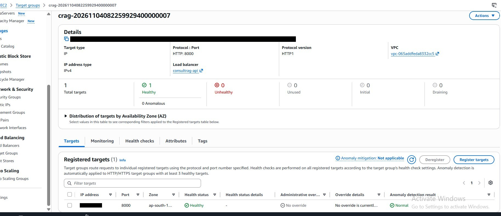

The load balancer's target group: target type IP, HTTP on port 8000, 1 total target, 1 healthy, 0 unhealthy. ARN and the target's private IP address masked.

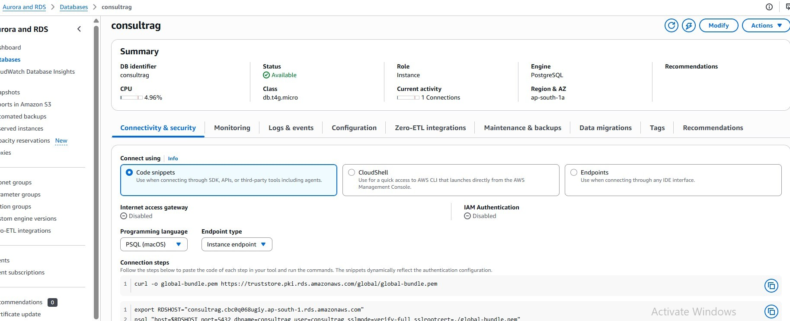

RDS instance `consultrag`: status Available, class `db.t4g.micro`, engine PostgreSQL, ap-south-1a, Internet access gateway Disabled. This screenshot does not show the security group rule or the PubliclyAccessible setting; `PubliclyAccessible: false` comes from the read-only `aws rds describe-db-instances` check in section 2. Nothing needed masking.

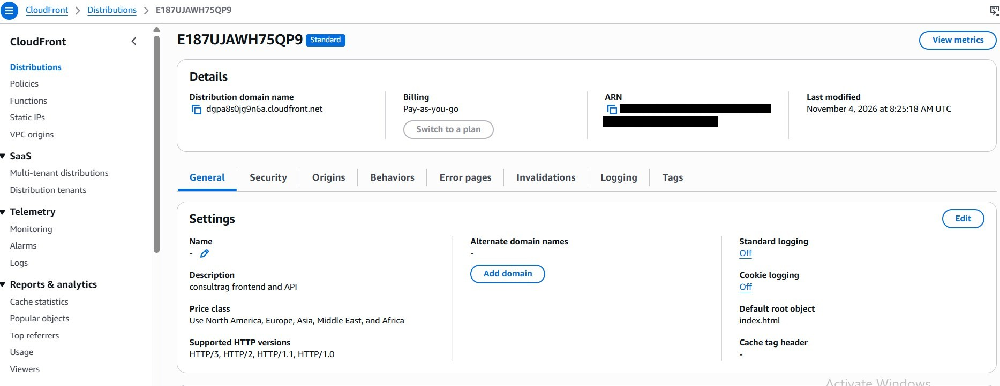

CloudFront distribution: domain `dgpa8s0jg9n6a.cloudfront.net`, description "consultrag frontend and API", HTTP/3, HTTP/2, HTTP/1.1 and HTTP/1.0, default root object `index.html`, standard logging off. The API path behaviours and origins are recorded from the CLI in section 2. ARN masked.

## Known limitations

- **Extractive answers.** The deployed API returns quoted passages from the documents, not generated prose. No language model was connected in this deployment.
- **No relevance threshold.** Retrieval always returns the closest passages a user is allowed to see, even when none answers the question. The page says the passages may not answer it.
- **HTTP between CloudFront and the load balancer.** Viewers used HTTPS, but the CloudFront to load balancer hop was plain HTTP, protected by the secret origin header and the CloudFront-only security group, not by TLS.
- **CSP in report-only mode.** The Content-Security-Policy was sent as `Content-Security-Policy-Report-Only`, so it was not enforced.
- **One API task, and the keyword index.** The service ran with one task. The BM25 keyword index lives in memory in each API process, so running more than one task would need a shared fix first.
- **No MFA on the IAM user** used for the deployment (0 MFA devices at the time of the check).
- **Database settings for a test environment:** single AZ, backup retention 0 days, deletion protection off.
- **ECR scan on push was off**, and the image was tagged `latest` with mutable tags.
- **The task had a public IP** (needed to pull from ECR without a NAT gateway), but its security group only accepted traffic from the load balancer.
- **No WAF** was attached to the CloudFront distribution.
- **An admin engagement-selector bug** was seen while the site was running: an admin with no explicit memberships saw no engagements. The fix is on `fix/admin-engagement-selector` and was not deployed in this snapshot.
- **Temporary environment.** It ran only for testing and was shut down to control cost on 4 November 2026. The CloudFront URL and the other endpoints in this report no longer respond.
- **Not measured:** there are no load, latency or availability figures in this report, and none should be inferred.

## How to reproduce

The full rebuild steps, post-deploy checks and the CSP enforcement step are in [aws-frontend-runbook.md](aws-frontend-runbook.md). The earlier API-only deployment notes are in [aws-deployment.md](aws-deployment.md). In short: build and push the API image to ECR, run `terraform apply` in `infra/terraform` with `desired_count=1`, run the migrations as a one-off task, then run `scripts/deploy_frontend.ps1` to build and upload the frontend.

## How this was built

I directed, deployed and tested this project on my own AWS account. Claude Code helped with design, code and debugging, and ran the automated tests and the read-only AWS checks recorded above.
