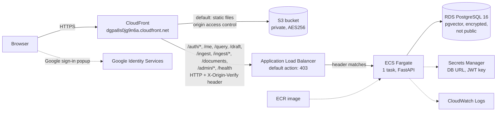

# ConsultRAG on AWS: evidence report

**Snapshot:** 4 November 2026. The AWS checks and live requests below ran between 09:57 and 10:04 UTC.
**Status:** a temporary environment in my own AWS account (region `ap-south-1`), run to test the deployment and then shut down to control cost. It is not a permanent public service.

This report records what was actually deployed and checked, so it can be verified rather than taken on trust. Each item says who verified it and how. Account IDs, IP addresses, emails, ARNs that contain the account ID, tokens, cookies and the origin secret header value are masked or left out.

## Summary

- The static Next.js frontend is served from a private S3 bucket through CloudFront over HTTPS. The FastAPI backend runs as one ECS Fargate task behind an Application Load Balancer, and CloudFront sends only the API paths there.
- The load balancer forwards only requests that carry a secret origin header. Its security group admits only CloudFront's origin-facing address range. A direct request from outside timed out.
- Data lives in an encrypted RDS PostgreSQL (pgvector) instance that is not publicly accessible. The database URL and the token signing key are in Secrets Manager.
- Through CloudFront, `GET /health` returned `200` and `GET /me` without a token returned a JSON `401`.
- In manual browser tests (reported below), two real Google accounts signed in, the first became admin, the second joined by invitation, and changing its clearance changed which documents it could retrieve.

## Architecture



## What was deployed

| Item | Value | How it was established |
|---|---|---|
| Repository | [github.com/Anurag-YadavIIH/consulting-rag-assistant](https://github.com/Anurag-YadavIIH/consulting-rag-assistant) | `git remote get-url origin` |
| Branch and commit | `main` at `77e1695` ("Labelled redaction bars, interactive sign-in panel, checked local build", 2026-11-04T07:54:44Z) | See the next two rows |
| Frontend | Built from `77e1695` | The live JavaScript contains text added in `77e1695` (the sign-in "how it works" panel and labelled redaction bars) and not the change in the later commit `33163db`. `index.html` in S3 was last modified 2026-11-04T09:07:47Z. |
| API image | `sha256:cfa75bf884a8b55955c0558b313509a14e15fc50ed4aa1ef0b0384cba3badcae`, tag `latest`, pushed 2026-11-04T08:52:19Z | ECR `describe-images`; the running task reports the same digest. **Inferred, not proven:** the image has no git label, but it was pushed after `77e1695`, and no API code changed between `77e1695` and the next commit. |

The fix for an admin engagement-selector bug found on the live site is on the branch `fix/admin-engagement-selector` (`33163db`). It was **not** deployed during this snapshot.

## What was verified, by whom and how

### 1. Automated tests (run by Claude Code)

Run on 2026-11-04 against commit `77e1695` (the deployed commit), on my Windows machine with local Postgres:

| Suite | Command | Result |
|---|---|---|
| Backend (pytest) | `python -m pytest -q` | 356 passed |
| Frontend (vitest) | `npx vitest run` | 208 passed (14 files) |
| Type check | `npx tsc --noEmit` | no errors |

These cover, among other things, engagement and clearance filtering, redaction before storage, the admin-only Team routes, the once-only initial admin grant, and the token refresh flow.

### 2. Read-only AWS checks (run by Claude Code)

All commands used `--profile consultrag --region ap-south-1` and only `describe`, `list` or read-only `get` operations. No secret values were read. Times are UTC on 2026-11-04.

| Time | What | Command | Result |
|---|---|---|---|
| 09:58:10 | ECS service | `aws ecs describe-services --cluster consultrag --services consultrag-api` | `ACTIVE`, running 1, desired 1, pending 0, launch type `FARGATE`, task definition `consultrag-api:2`, deployment `COMPLETED` |
| 09:58:13 | Task definition | `aws ecs describe-task-definition --task-definition consultrag-api:2` | 1 vCPU, 3 GB, `FARGATE`. Environment names only: `APP_ENV=production`, `DEV_AUTH_BYPASS=false`, `INVITATION_TTL_DAYS=14`, `OAUTH_AUDIENCE`, `INITIAL_ADMIN_EMAILS` (set, value not shown), `ALLOWED_EMAIL_DOMAINS` (empty). Secrets injected by reference: `APP_JWT_SECRET`, `DATABASE_URL` |
| 09:58:20 | Running task | `aws ecs describe-tasks --cluster consultrag --tasks <task-id>` | `RUNNING`, `FARGATE`, started 09:00:16, image digest `sha256:cfa75bf8...` |
| 09:59:12 | Listener | `aws elbv2 describe-listeners --load-balancer-arn <alb-arn>` | HTTP on port 80. Default action: `fixed-response` `403` with body `{"detail":"Forbidden"}` |
| 09:59:15 | Listener rules | `aws elbv2 describe-rules --listener-arn <listener-arn>` | Priority 10: condition type `http-header` on `X-Origin-Verify` (value redacted), action `forward`. Default rule: `fixed-response` |
| 09:59:18 | Target health | `aws elbv2 describe-target-health --target-group-arn <tg-arn>` | 1 target on port 8000, `healthy` |
| 09:59:20 | Load balancer security group | `aws ec2 describe-security-groups --group-ids <alb-sg>` | Inbound TCP 80 only from prefix list `com.amazonaws.global.cloudfront.origin-facing` (confirmed with `aws ec2 describe-managed-prefix-lists`) |
| 09:59:24 | Task security group | `aws ec2 describe-security-groups --group-ids <task-sg>` | Inbound TCP 8000 only from the load balancer's security group |
| 09:59:30 | CloudFront | `aws cloudfront get-distribution --id <distribution-id>` | `Deployed`, enabled, domain `dgpa8s0jg9n6a.cloudfront.net`, HTTP/2 and HTTP/3. Origins: the S3 bucket through origin access control, and the load balancer (`http-only`, custom header `X-Origin-Verify` with the value removed). Default behaviour goes to S3 with `redirect-to-https`. API path behaviours to the load balancer: `/auth/*`, `/me`, `/query`, `/draft`, `/ingest`, `/ingest/*`, `/documents`, `/admin/*`, `/health` |
| 09:59:33 | RDS | `aws rds describe-db-instances` | `available`, `postgres` `16.13`, `db.t4g.micro`, storage encrypted `true`, `PubliclyAccessible` `false`, single AZ, backup retention 0 days, deletion protection off |
| 09:59:39 | S3 public access | `aws s3api get-public-access-block --bucket <frontend-bucket>` | `BlockPublicAcls`, `IgnorePublicAcls`, `BlockPublicPolicy`, `RestrictPublicBuckets` all `true` |
| 09:59:42 | S3 encryption | `aws s3api get-bucket-encryption --bucket <frontend-bucket>` | `AES256` (SSE-S3) |
| 09:59:48 | ECR | `aws ecr describe-images --repository-name consultrag-api` | `latest` = `sha256:cfa75bf8...`, pushed 08:52:19, about 643 MB. Scan on push is off |
| 09:59:51 | Secrets Manager | `aws secretsmanager list-secrets --query "SecretList[].{Name:Name,LastChanged:LastChangedDate}"` | Names only: `consultrag/database-url`, `consultrag/app-jwt-secret` |
| 09:59:53 | CloudWatch | `aws logs describe-log-groups --log-group-name-prefix /ecs/consultrag` | `/ecs/consultrag-api`, retention 7 days |
| 10:02:34 | Recent API logs | `aws logs filter-log-events --log-group-name /ecs/consultrag-api --start-time <3 hours ago>` | 368 events, none containing an email address. Excerpt below (user numbers masked) |
| 10:03:38 | IAM MFA | `aws iam list-mfa-devices` | 0 MFA devices on the IAM user used for the deployment |

Log excerpt (only lines without personal data; access-log lines are left out because they contain client IP addresses):

```text
2026-11-04T08:55:23Z  Schema ready: table 'chunks' (dim=384)
2026-11-04T08:55:23Z  Audit schema ready: table 'audit_events'
2026-11-04T08:55:23Z  Authz schema ready
2026-11-04T09:00:03Z  INFO:     Application startup complete.
2026-11-04T09:09:00Z  INFO:     consultrag.api.routes.auth: refresh rejected: reason=missing_cookie
2026-11-04T09:09:57Z  INFO:     consultrag.authz.team: sign-in grant applied: initial_admin for user_id=<N>
2026-11-04T09:43:54Z  INFO:     consultrag.authz.team: sign-in grant applied: invitation for user_id=<N>
```

### 3. Live HTTP checks (run by Claude Code)

| Time (UTC) | Request | Result |
|---|---|---|
| 10:00:54 | `curl -s -i https://dgpa8s0jg9n6a.cloudfront.net/health` | `200`, body `{"status":"ok","version":"0.2.0"}`, `server: uvicorn` |
| 10:00:54 | `curl -s -i https://dgpa8s0jg9n6a.cloudfront.net/me` (no token) | `401`, `Content-Type: application/json`, body `{"detail":"missing Authorization header"}` |
| 10:00:54 | `curl -s -D - -o /dev/null https://dgpa8s0jg9n6a.cloudfront.net/` | `200` with `Strict-Transport-Security`, `X-Content-Type-Options: nosniff`, `X-Frame-Options: DENY`, `Referrer-Policy: strict-origin-when-cross-origin` and `Content-Security-Policy-Report-Only` |
| 10:01:20 | `curl --max-time 10 http://<alb-dns-name>/health` (direct to the load balancer) | No response; curl exit code 28 (timed out after 10 s) |
| 10:01:30 | The same with a guessed `X-Origin-Verify` header | No response; curl exit code 28 |

### 4. Manual browser tests (reported by me from screenshots)

I ran these myself in a browser on the CloudFront URL. They are reported by me from my screenshots; Claude Code did not observe them directly.

1. Real Google sign-in worked for two accounts on the CloudFront URL.
2. The first account became admin through `INITIAL_ADMIN_EMAILS`.
3. An invited second account joined as Analyst, clearance 1.
4. As Analyst, "What is the main barrier to adoption?" returned 2 sources, both `deck.pptx`. `acme_research.txt` was hidden.
5. After changing that account to Manager, clearance 2, the same question returned 3 sources including `acme_research.txt`.
6. Passages showed labelled redactions for email, phone and medical record number.

Server-side corroboration for items 2 and 3 (checked by Claude Code): the API log shows `sign-in grant applied: initial_admin` at 09:09:57 UTC and `sign-in grant applied: invitation` at 09:43:54 UTC.

## Known limitations

- **Extractive answers.** The deployed API returns quoted passages from the documents, not generated prose. No language model was connected in this deployment.
- **No relevance threshold.** Retrieval always returns the closest passages a user is allowed to see, even when none answers the question. The page says the passages may not answer it.
- **HTTP between CloudFront and the load balancer.** Viewers use HTTPS, but the CloudFront to load balancer hop is plain HTTP, protected by the secret origin header and the CloudFront-only security group, not by TLS.
- **CSP in report-only mode.** The Content-Security-Policy is sent as `Content-Security-Policy-Report-Only`, so it is not enforced.
- **One API task, and the keyword index.** The service ran with one task. The BM25 keyword index lives in memory in each API process, so running more than one task would need a shared fix first.
- **No MFA on the IAM user** used for the deployment (0 MFA devices at the time of the check).
- **Database settings for a test environment:** single AZ, backup retention 0 days, deletion protection off.
- **ECR scan on push is off**, and the image is tagged `latest` with mutable tags.
- **The task has a public IP** (needed to pull from ECR without a NAT gateway), but its security group only accepts traffic from the load balancer.
- **No WAF** is attached to the CloudFront distribution.
- **An admin engagement-selector bug** was seen on the live site: an admin with no explicit memberships saw no engagements. The fix is on `fix/admin-engagement-selector` and was not deployed in this snapshot.
- **Temporary environment.** It ran for testing and was then shut down to control cost. Anyone reading this later should not expect the URL above to work.
- **Not measured:** there are no load, latency or availability figures in this report, and none should be inferred.

## How to reproduce

The full rebuild steps, post-deploy checks and the CSP enforcement step are in [aws-frontend-runbook.md](aws-frontend-runbook.md). The earlier API-only deployment notes are in [aws-deployment.md](aws-deployment.md). In short: build and push the API image to ECR, run `terraform apply` in `infra/terraform` with `desired_count=1`, run the migrations as a one-off task, then run `scripts/deploy_frontend.ps1` to build and upload the frontend.

## How this was built

I directed, deployed and tested this project on my own AWS account. Claude Code helped with design, code and debugging, and ran the automated tests and the read-only AWS checks recorded above.
